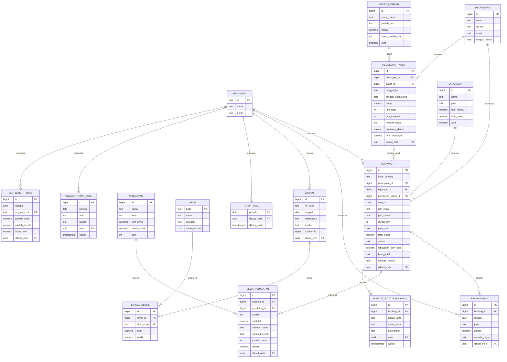

# Sistem Akuntansi Pendapatan Sewa Lapangan Padel pada Smash Padel Club

Tugas UTS mata kuliah **Pengkodean dan Pemrograman** – S1 Akuntansi.

🌐 **Demo website:** https://zayyanberyl-coding.github.io/sistem-akuntansi-padel/
(memerlukan login; akun demo diberikan terpisah saat presentasi)

Web app satu halaman (single-page) untuk mencatat booking lapangan padel, pembayaran,
sewa peralatan, dan penjualan paket member. Setiap transaksi **otomatis dijurnal**
oleh trigger database, lalu diringkas menjadi Jurnal Umum, Buku Besar, dan Laporan Pendapatan.
"Smash Padel Club" adalah nama contoh; seluruh data di database adalah **data simulasi**.

## Teknologi

| Bagian   | Teknologi |
|----------|-----------|
| Frontend | HTML, CSS, JavaScript murni (tanpa framework), satu `index.html` dengan sidebar |
| Backend  | [Supabase](https://supabase.com) (PostgreSQL) + trigger PL/pgSQL + Row Level Security |
| Login    | Supabase Auth (email + password), peran **owner** dan **admin** |
| Koneksi  | `supabase-js` v2 via CDN, memakai **anon / publishable key** saja |
| Tampilan | Font [Inter](https://fonts.google.com/specimen/Inter), ikon [Tabler Icons](https://tabler.io/icons), foto dari [Unsplash](https://unsplash.com/s/photos/padel-court) (lisensi gratis) |

## Fitur

| Menu | Isi |
|------|-----|
| **Login** | Hanya staf terdaftar yang bisa membuka aplikasi; data pelanggan tidak bisa dibaca publik |
| **Dashboard** | Pendapatan bulan ini, kas/bank/QRIS, pendapatan diterima di muka, rincian & donut pendapatan, tren harian, jam sibuk, pemakaian lapangan, jadwal berikutnya, **peringatan booking lewat waktu + tombol selesaikan massal** |
| **Booking** | Form booking, pratinjau tarif normal/prime time, **cek bentrok jadwal**, grid jadwal, tandai selesai, **pembatalan dengan kebijakan refund/hangus**, **cetak konfirmasi booking** |
| **Pembayaran** | Terima DP / pelunasan (tunai/transfer/QRIS), status otomatis `dp` / `lunas`, **cetak kwitansi** (dengan terbilang), **settlement QRIS ke Bank + biaya MDR** (owner), saldo QRIS belum cair & umurnya |
| **Peralatan** | Sewa raket & bola (stok otomatis berkurang), pengembalian (stok bertambah), denda kerusakan dihitung server; tambah/edit peralatan khusus owner |
| **Member** | Data pelanggan, jenis paket (khusus owner), penjualan paket, sisa jam, **pengakuan sisa paket kedaluwarsa** |
| **Jurnal Umum** | Jurnal otomatis per periode + cek keseimbangan + siapa yang mencatat |
| **Buku Besar** | Mutasi per akun dengan saldo awal dan saldo berjalan |
| **Laporan Pendapatan** | Pendapatan per akun, rincian per lapangan, **penerimaan & refund per metode (Kas/Bank/QRIS)**, siap cetak, **tutup buku per bulan** (owner) + riwayat |

### Aturan tarif
- Jam operasional 07.00–23.00, booking per jam penuh.
- **Normal**: Senin–Jumat 07.00–17.00.
- **Prime time**: Senin–Jumat 17.00–23.00, serta Sabtu–Minggu seharian.
- Tarif dihitung per jam, jadi booking 16.00–18.00 di hari kerja = 1 jam normal + 1 jam prime.

### Kebijakan pembatalan (ditentukan database, bukan browser)
| Kondisi | Hasil | Siapa yang boleh |
|---|---|---|
| Booking paket member / belum ada pembayaran | Tanpa dana (jam paket dikembalikan) | owner & admin |
| Batal oleh **klub**, atau oleh pelanggan **≥ 24 jam** sebelum main | **Refund** penuh | **owner saja** |
| Batal oleh pelanggan **< 24 jam** sebelum main | Uang yang sudah dibayar **hangus** | owner & admin |

### Pengendalian internal
- Peran: **owner** (semua akses, tarif, stok, paket, refund) dan **admin** (operasional harian).
- Tanggal transaksi tidak boleh di masa depan; mundur > 3 hari hanya owner.
- Booking tidak bisa dibuat untuk tanggal lampau dan tidak bisa "selesai" sebelum jam main.
- Tarif, denda, jenis pembayaran, dan hasil pembatalan dihitung server.
- Setiap transaksi dan jurnal mencatat **siapa** pembuatnya; setiap perubahan status booking masuk **riwayat**.
- Jurnal hanya bisa dibaca dari aplikasi; tidak ada izin `DELETE`.
- **Tutup buku** per bulan (owner saja): bulan yang sudah ditutup tidak bisa lagi menerima transaksi maupun jurnal.
  Syarat: bulan sudah berakhir dan semua booking di bulan itu selesai/batal. Jurnal otomatis yang terlambat
  (pengakuan pendapatan, sisa paket kedaluwarsa) dicatat di tanggal 1 bulan berikutnya yang masih terbuka.
  Membuka kembali hanya oleh owner, wajib alasan, dan tercatat di riwayat.
- **Settlement QRIS** (owner saja — penerima uang tidak mencatat pencairan): angka diambil dari laporan settlement
  penyedia QRIS (jumlah kotor & jumlah masuk Bank); biaya MDR dihitung server; nomor referensi tidak boleh ganda;
  jumlah kotor tidak boleh melebihi Saldo QRIS yang belum cair.

## Logika Akuntansi (jurnal otomatis via trigger)

| Transaksi | Debit | Kredit | Trigger / fungsi |
|-----------|-------|--------|------------------|
| Terima DP / pelunasan booking | Kas / Bank / QRIS | Pendapatan Diterima di Muka | `pembayaran_sesudah_insert` |
| Booking selesai dimainkan | Pendapatan Diterima di Muka | Pendapatan Sewa Lapangan | `booking_sesudah_update` |
| Batal, uang hangus | Pendapatan Diterima di Muka | Pendapatan Lain-lain | `booking_sesudah_update` |
| Batal, refund | Pendapatan Diterima di Muka | Kas / Bank / QRIS | `booking_sesudah_update` |
| Beli paket member | Kas / Bank / QRIS | Pendapatan Diterima di Muka | `pembelian_paket_sesudah_insert` |
| Main pakai paket (diakui per jam) | Pendapatan Diterima di Muka | Pendapatan Sewa Lapangan | `booking_sesudah_update` |
| Sisa paket kedaluwarsa (breakage) | Pendapatan Diterima di Muka | Pendapatan Paket Member Kedaluwarsa | `akui_breakage_paket()` |
| Sewa peralatan | Kas / Bank / QRIS | Pendapatan Sewa Peralatan | `sewa_sesudah_insert` |
| Denda kerusakan peralatan | Kas / Bank / QRIS | Pendapatan Denda | `sewa_sesudah_update` |
| Settlement QRIS: uang cair ke rekening | Bank | Saldo QRIS | `settlement_sesudah_insert` |
| Settlement QRIS: potongan MDR | Beban MDR QRIS | Saldo QRIS | `settlement_sesudah_insert` |

**Mengapa DP dicatat sebagai Pendapatan Diterima di Muka?** Uang sudah diterima,
tetapi jasanya (lapangan) belum diberikan. Sesuai model pendapatan dari kontrak
dengan pelanggan (PSAK 72, kini bernomor PSAK 115), uang itu masih berupa
**liabilitas kontrak** dan baru diakui sebagai pendapatan saat lapangan dipakai.

### Bagan akun

| Kode | Nama | Kategori | Saldo normal |
|------|------|----------|--------------|
| 1-101 | Kas | Aset | Debit |
| 1-102 | Bank | Aset | Debit |
| 1-103 | Saldo QRIS | Aset | Debit |
| 2-101 | Pendapatan Diterima di Muka | Kewajiban | Kredit |
| 4-101 | Pendapatan Sewa Lapangan | Pendapatan | Kredit |
| 4-102 | Pendapatan Sewa Peralatan | Pendapatan | Kredit |
| 4-103 | Pendapatan Denda | Pendapatan | Kredit |
| 4-104 | Pendapatan Paket Member Kedaluwarsa | Pendapatan | Kredit |
| 4-201 | Pendapatan Lain-lain | Pendapatan | Kredit |
| 6-101 | Beban MDR QRIS | Beban | Debit |

### Alur status booking

```
menunggu ──bayar DP──▶ dp ──pelunasan──▶ lunas ──dimainkan──▶ selesai
    │                  │                   │
    └──────────────────┴───────────────────┴──────▶ batal (refund / hangus / tanpa dana)
```
Booking dengan paket member langsung berstatus `lunas` dan jam paketnya dipotong.
Jika dibatalkan, jam paket dikembalikan.

## ERD



## Struktur Folder

```
sistem-akuntansi-padel/
├── backend/
│   ├── schema.sql         # 16 tabel, relasi, view, keamanan (RLS & peran)
│   ├── triggers.sql       # tarif, cek bentrok, stok, kebijakan batal, jurnal otomatis
│   ├── seed.sql           # data contoh (sedikit) + hubungkan akun login ke peran
│   └── seed_tambahan.sql  # data contoh 1,5 bulan (opsional)
├── frontend/
│   ├── index.html         # satu halaman + sidebar
│   ├── css/style.css
│   ├── img/logo.svg       # logo Smash Padel Club (juga dipakai sebagai favicon)
│   └── js/
│       ├── supabase.js    # koneksi (URL + publishable key)
│       ├── app.js         # fungsi bantu + pindah menu
│       ├── auth.js        # login, logout, peran pengguna
│       ├── animasi.js     # animasi & efek interaksi (count-up, skeleton, dll.)
│       ├── cetak.js       # cetak konfirmasi booking & kwitansi
│       ├── dashboard.js
│       ├── booking.js
│       ├── pembayaran.js
│       ├── peralatan.js
│       ├── member.js
│       ├── jurnal.js
│       ├── bukubesar.js
│       └── laporan.js
├── tests/
│   ├── uji-database.html  # penjalan uji otomatis (buka dengan Live Server)
│   ├── daftar-uji.js      # 50 uji: integritas jurnal, akses, peran, validasi, akuntansi, tutup buku, settlement
│   ├── supabase-tiruan.sql# tiruan Auth & hak bawaan Supabase untuk database uji
│   └── CHECKLIST_UAT.md   # checklist uji klik antarmuka (manual)
├── index.html             # pengalih ke frontend/ (untuk GitHub Pages)
├── .gitignore
└── README.md
```

## Cara Menjalankan

### 1. Buat akun login
1. Buat project di [supabase.com](https://supabase.com).
2. **Authentication → Sign In / Providers**: matikan *Allow new users to sign up*
   (supaya orang lain tidak bisa mendaftar sendiri).
3. **Authentication → Users → Add user → Create new user**, centang *Auto Confirm User*:
   - `owner@smashpadel.test` (peran owner)
   - `admin@smashpadel.test` (peran admin)

   Boleh memakai email lain; sesuaikan email di bagian 0 `backend/seed.sql`.

### 2. Siapkan database
Di **SQL Editor → New query**, jalankan berurutan:
1. `backend/schema.sql`
2. `backend/triggers.sql`
3. `backend/seed.sql` — hasil terakhir harus menunjukkan `total_debit` = `total_kredit`
4. *(Opsional)* `backend/seed_tambahan.sql` — cukup sekali; menambah ±25 pelanggan dan
   ±650 booking selama 45 hari terakhir s.d. 10 hari ke depan, lengkap dengan pembayaran,
   pembatalan (hangus & refund), sewa peralatan, dan paket kedaluwarsa.

> `schema.sql` menghapus tabel lama sebelum membuat ulang (akun login tidak ikut terhapus).
> Menjalankan ulang keempat file juga cara menyegarkan data demo agar tanggalnya mengikuti hari ini.

### 3. Hubungkan frontend
1. **Project Settings → API Keys**: salin **Project URL** dan **Publishable key** (atau *anon* key).
2. Tempel ke `frontend/js/supabase.js`.

> ⚠ **Jangan pernah** memakai `service_role` / `secret` key di frontend. Key itu
> melewati semua aturan keamanan. Aplikasi ini akan menolak berjalan jika key
> tersebut terdeteksi.

### 4. Jalankan
- Di VS Code pasang ekstensi **Live Server**, klik kanan `frontend/index.html` → **Open with Live Server**,
  lalu login dengan salah satu akun di langkah 1.

## Keamanan
- Pengunjung tanpa login **tidak bisa membaca maupun menulis data** apa pun (hak `anon` dicabut).
- Akun login yang belum diberi peran tidak melihat data (RLS memeriksa tabel `pengguna`).
- Jurnal hanya bisa **dibaca**; isinya dibuat trigger (`security definer`), sehingga tidak bisa dipalsukan.
- Fungsi `buat_jurnal` tidak bisa dipanggil dari aplikasi.
- Tidak ada policy `DELETE` (RLS memblokir penghapusan); transaksi dibatalkan lewat status sehingga jejak audit tetap ada.
- Pemindaian rahasia pada seluruh file & riwayat Git: tidak ada secret key.

## Pengujian
### 1. Uji otomatis database (`tests/uji-database.html`)
Keempat file SQL asli dijalankan di PostgreSQL 18 **di dalam browser** (PGlite), dengan tiruan
modul Auth & hak bawaan Supabase (`tests/supabase-tiruan.sql`). **Tidak menyentuh Supabase live.**
Isi uji (`tests/daftar-uji.js`, 50 uji + 5 tahap pemasangan):
- **Integritas jurnal** — total debit = kredit, tiap jurnal seimbang, bernomor bukti & bersumber.
- **Akses tanpa login** — baca pelanggan/jurnal, buat booking, panggil fungsi: semua ditolak.
- **Peran & otorisasi** — akun tanpa peran tidak melihat data; admin tidak bisa ubah tarif, refund,
  menulis jurnal/riwayat, atau menghapus booking; owner bisa ubah tarif & refund; jejak audit terisi.
- **Validasi transaksi** — tanggal lampau/masa depan, batas mundur 3 hari, bentrok jadwal, tarif campuran,
  lebih bayar, stok kurang, jadwal terkunci, status final.
- **Logika akuntansi** — pengakuan pendapatan, QRIS → 1-103, hangus, selesaikan massal, denda server, breakage.
- **Tutup buku** — hanya owner, hanya bulan yang sudah berakhir & tuntas, transaksi/jurnal di bulan tertutup ditolak,
  jurnal otomatis terlambat digeser ke bulan terbuka, buka kembali wajib alasan.
- **Settlement QRIS** — owner saja, 2 jurnal otomatis (Bank & Beban MDR / Saldo QRIS), MDR dihitung server,
  tidak melebihi saldo, referensi tidak ganda, saldo & umur QRIS di data demo cocok dengan jurnal.

Cara menjalankan: buka folder proyek di VS Code → klik kanan `tests/uji-database.html` →
**Open with Live Server** (perlu internet untuk memuat PGlite). Hasil tampil dalam ±5 detik.
Setiap uji dijalankan dalam transaksi yang di-*rollback*, jadi uji tidak saling memengaruhi.

Hasil terakhir: **55/55 lulus** (22 Oktober 2026).

### 2. Uji penerimaan pengguna (`tests/CHECKLIST_UAT.md`)
Daftar 33 langkah uji klik di aplikasi untuk peran owner & admin (login, booking, pembayaran, tutup buku, settlement QRIS,
pembatalan, dashboard, peralatan, laporan, cetak). Diisi manual oleh penguji.

## Keterbatasan
- Data dan nama usaha bersifat simulasi; belum divalidasi dengan klub padel nyata.
- Pajak daerah (PBJT) belum diterapkan; objek dan tarifnya bergantung Perda setempat.
- Pembelian stok peralatan baru tidak dijurnal (sistem fokus pada siklus pendapatan).
- Paket Supabase Free menjeda project setelah 1 minggu tidak aktif dan tanpa backup otomatis;
  untuk operasi nyata disarankan paket berbayar.
